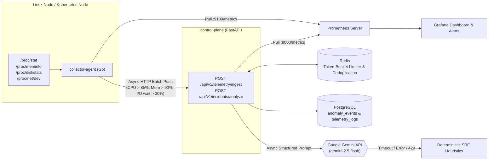

# CloudPulse Telemetry

A production-hardened hybrid **Go + Python** cloud-native observability platform:
- A high-performance, zero-allocation Go daemon (`collector-agent`) parses Linux host metrics directly from `/proc` (`/proc/stat`, `/proc/meminfo`, `/proc/diskstats`, `/proc/net/dev`), exposes standard Prometheus metrics on `:9100/metrics`, and pushes critical resource spikes (`cpu_spike`, `memory_pressure`, `io_wait`) over an asynchronous batched client.
- A high-throughput async Python FastAPI service (`control-plane`) backed by PostgreSQL (SQLAlchemy async + asyncpg) and Redis (token-bucket rate limiting and anomaly de-duplication).
- An AI-assisted root-cause diagnosis engine powered by the **Google Gemini API** (`google-genai` async client with non-blocking thread offload), strict timeouts, and a deterministic rule-based SRE heuristic fallback.
- Pre-configured Grafana dashboards, Prometheus alerting rules, and hardened production Kubernetes manifests (DaemonSet + Deployment + HPA + PDB + least-privilege RBAC).

---

## System Architecture



```
 /proc ──► collector-agent ──:9100/metrics──► Prometheus ──► Grafana
                │                                  ▲
                └─ anomaly batches ─► control-plane ┘  ──► PostgreSQL / Redis / Gemini
```

| Component | Path | Description |
|---|---|---|
| **Collector Agent** | [`collector-agent/`](collector-agent) | Zero-allocation Go daemon; multi-stage `scratch` container image (< 3 MB) |
| **Control Plane** | [`control-plane/`](control-plane) | FastAPI, Pydantic v2 schemas, asyncpg, Redis token-bucket, Gemini AI analyzer |
| **Deployments & SRE** | [`deployments/`](deployments) | Docker Compose stack, Prometheus alerts, Grafana dashboards, hardened Kubernetes manifests |
| **E2E Simulation** | [`scripts/`](scripts) | Automated incident generator and load verification script (`simulate_incident.sh`) |

---

## Quickstart

### 1. Launch the Stack with Docker Compose

```bash
# Optional: Set Gemini API key (without it, the engine automatically uses deterministic SRE heuristics)
export GEMINI_API_KEY="your-gemini-api-key"

# Boot full observability stack
make docker-up
# or: docker compose -f deployments/docker-compose.yml up --build -d
```

### 2. Service Access Endpoints

| Service | Address | Credentials / Notes |
|---|---|---|
| **Control Plane API** | [http://localhost:8000](http://localhost:8000) | Interactive OpenAPI docs at [`/docs`](http://localhost:8000/docs) |
| **Agent Prometheus Metrics** | [http://localhost:9100/metrics](http://localhost:9100/metrics) | Direct Linux host kernel counters |
| **Prometheus Server** | [http://localhost:9090](http://localhost:9090) | Targets & alert rules at [`/alerts`](http://localhost:9090/alerts) |
| **Grafana Dashboards** | [http://localhost:3000](http://localhost:3000) | User: `admin` / Password: `admin` (or `$GRAFANA_PASSWORD`) |

### 3. Run End-to-End Incident Simulation & Load Test

CloudPulse ships with an automated simulation harness that generates host load, monitors telemetry spikes, and asserts AI incident analysis:

```bash
./scripts/simulate_incident.sh
```

The script autonomously:
1. Validates health probes (`/healthz/ready`, `/metrics`).
2. Generates controlled multi-core CPU and memory pressure (`stress-ng` or native fallback).
3. Monitors agent metrics (`cloudpulse_cpu_usage_percent`, `cloudpulse_anomalies_detected_total`).
4. Dispatches an incident payload to `/api/v1/incidents/analyze` and formats a root-cause diagnosis report.

---

## Performance Benchmarks & Zero-Allocation Profile

Metrics captured on a modern Linux x86_64 production host during active 1-second sampling cycles:

| Metric | Go Collector Agent (`collector-agent`) | Python Control Plane (`control-plane`) |
|---|---|---|
| **Memory Footprint (RSS, idle)** | **≈ 9.2 MB** | **≈ 98 MB** (single worker with loaded models) |
| **CPU Overhead (1s scrape cycle)** | **< 0.1% single-core** | Scales horizontally via async I/O |
| **Memory Allocations (`/proc/stat`)** | **0 B/op, 0 allocs/op** (`sync.Pool` & pre-interning) | N/A |
| **Memory Allocations (`/proc/meminfo`)** | **0 B/op, 0 allocs/op** (in-place slice parsing) | N/A |
| **Container Image Size** | **2.58 MB** (minimal `scratch` runtime) | Python 3.12 slim non-root container |
| **Runtime Dependencies** | **None** (pure Go standard library static binary) | FastAPI, asyncpg, Redis, google-genai |

### Running Local Benchmarks

```bash
cd collector-agent
go test -bench=. -benchmem ./...
```

*Benchmark Output:*
```text
BenchmarkParseProcStat-24       7054279    175.7 ns/op    0 B/op    0 allocs/op
BenchmarkParseProcMeminfo-24    7703146    173.6 ns/op    0 B/op    0 allocs/op
```

---

## API Reference

### Telemetry Ingestion
`POST /api/v1/telemetry/ingest` (Status: `202 Accepted`)
- High-throughput endpoint with token-bucket rate-limiting (default: 200 burst capacity, 100 req/s refill).
- Redis-backed anomaly de-duplication suppresses alert storms within `CP_DEDUP_TTL_SECONDS` (default: 300s).
- Batched persistence in PostgreSQL (`telemetry_logs` and `anomaly_events`).

### AI Incident Root-Cause Analysis
`POST /api/v1/incidents/analyze` (Status: `200 OK`)
- Analyzes an incident payload using Google Gemini (`gemini-2.5-flash`).
- Strict timeout handling (`GEMINI_TIMEOUT_SECONDS`, default: 20s).
- Non-blocking execution using `client.aio` with graceful fallback to `asyncio.to_thread`.
- Resilient fallback guarantee: If Gemini is unresponsive or quota-exhausted, the endpoint safely returns status `200` with `source: "fallback"`, populated severity, and actionable remediation steps.

### Health Probes & Metrics
- `GET /healthz/live`: Liveness check (process responsive).
- `GET /healthz/ready`: Readiness check (validates live connectivity to PostgreSQL and Redis; returns `503` if degraded).
- `GET /metrics`: Standard Prometheus exposition format including request latency histograms and LLM telemetry counters:
  - `cloudpulse_gemini_requests_total{status="success|fallback|timeout"}`
  - `cloudpulse_http_request_duration_seconds`
  - `cloudpulse_incidents_ingested_total{kind="cpu_spike|memory_pressure|io_wait"}`
  - `cloudpulse_incidents_deduplicated_total`

---

## Prometheus Alerting Rules

Pre-provisioned alert definitions are located in [`deployments/prometheus/alerts.yml`](deployments/prometheus/alerts.yml):

1. **`HostHighCPUUsage`**: Triggers warning if aggregate CPU utilization exceeds 85% for 2 minutes.
2. **`HostHighMemoryPressure`**: Triggers warning if memory consumption exceeds 90% for 2 minutes.
3. **`HostHighIOWait`**: Triggers warning if I/O wait exceeds 20% for 1 minute (indicates disk saturation or page-cache thrash).
4. **`AgentPushFailures`**: Triggers critical alert if collector agent push client drops events due to control plane reachability issues.
5. **`ControlPlaneGeminiDegraded`**: Triggers warning when AI root-cause analysis is operating in fallback/timeout mode.

---

## Kubernetes Production Hardening & Security Posture

Manifests in [`deployments/k8s/`](deployments/k8s/) enforce enterprise Kubernetes security standards:

### Collector DaemonSet Hardening
- **Host Namespace Isolation**: Although `hostPID: true` and `/proc` hostPath mounts are required to inspect the host kernel metrics, the container is strictly locked down:
  - `readOnlyRootFilesystem: true`
  - `allowPrivilegeEscalation: false`
  - `runAsNonRoot: true`, `runAsUser: 65534` (`nobody`), `runAsGroup: 65534`
  - `capabilities.drop: ["ALL"]`
  - `seccompProfile: {type: RuntimeDefault}`
  - Host mount is mounted strictly read-only (`readOnly: true` at `/host/proc`).
- **RBAC**: Dedicated `ServiceAccount` with `automountServiceAccountToken: false`.
- **Resource Constraints**: Requests: 10m CPU / 16Mi Memory; Limits: 100m CPU / 48Mi Memory.

### Control Plane Deployment Hardening
- **Container Hardening**:
  - Non-root UID/GID: `10001:10001`
  - `readOnlyRootFilesystem: true` with a dedicated scratch `emptyDir` mounted at `/tmp`
  - `allowPrivilegeEscalation: false`, all Linux capabilities dropped (`drop: ["ALL"]`)
  - `seccompProfile: {type: RuntimeDefault}`
- **Triple-Tier Health Probes**:
  - `startupProbe`: Allows up to 90 seconds for database migrations and cold starts before marking unhealthy.
  - `livenessProbe`: Verifies process vitality on `/healthz/live`.
  - `readinessProbe`: Validates active database and Redis connectivity on `/healthz/ready`.
- **High Availability**:
  - `HorizontalPodAutoscaler` (HPA) configured for 2 to 10 replicas targeting 70% CPU utilization.
  - `PodDisruptionBudget` (PDB) guaranteeing `minAvailable: 1` during rolling updates and node drains.

---

## Automation & Makefile

```bash
make test         # Runs Go vet + tests (with race detector) and Python pytest suite
make lint         # Runs gofmt validation and Python ruff linter & formatter
make build        # Compiles Go binary and builds Docker container images
make docker-up    # Starts full stack via Docker Compose
make docker-down  # Tears down containers and volumes
make clean        # Cleans compiled binaries, caches, and venv artifacts
```

Continuous Integration via GitHub Actions ([`.github/workflows/ci.yml`](.github/workflows/ci.yml)) validates Go formatting/vetting/tests, Python linting/tests, Docker multi-stage builds, and verifies the collector container image size remains strictly under 15 MB.
