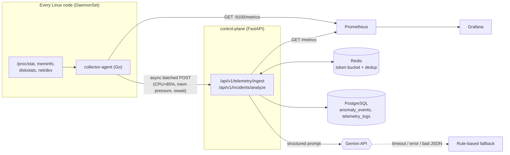

# CloudPulse Telemetry

A hybrid **Go + Python** cloud-native observability platform: a tiny Go daemon reads Linux
host metrics straight from `/proc`, exposes them to Prometheus, and pushes anomaly spikes to a
FastAPI control plane that stores incidents in PostgreSQL, de-duplicates and rate-limits with
Redis, and produces AI root-cause diagnoses with Google Gemini.

## Architecture



```
 /proc ──► collector-agent ──:9100/metrics──► Prometheus ──► Grafana
                │                                  ▲
                └─ anomaly batches ─► control-plane ┘  ──► PostgreSQL / Redis / Gemini
```

| Component | Path | Notes |
|---|---|---|
| Collector | [`collector-agent/`](collector-agent) | Go stdlib only; `scratch` image |
| Control plane | [`control-plane/`](control-plane) | FastAPI, Pydantic v2, SQLAlchemy async + asyncpg, Redis |
| Infra | [`deployments/`](deployments) | Compose, Prometheus, Grafana, Kubernetes |

## Quickstart

```bash
export GEMINI_API_KEY=...        # optional; without it /analyze uses the rule-based fallback
cd deployments
docker compose up --build
```

| Service | URL |
|---|---|
| Control plane (Swagger at `/docs`) | http://localhost:8000 |
| Collector metrics | http://localhost:9100/metrics |
| Prometheus | http://localhost:9090 |
| Grafana (admin / `$GRAFANA_PASSWORD`, default `admin`) | http://localhost:3000 |

Or from the repo root: `make docker-up` / `make docker-down`, `make test`, `make build`, `make clean`.

### Agent configuration (env vars)

`PROC_ROOT` (`/proc`), `LISTEN_ADDR` (`:9100`), `NODE_NAME`, `SAMPLE_INTERVAL` (`5s`),
`CONTROL_PLANE_URL` (push disabled when empty), `CPU_THRESHOLD` (85), `MEM_USED_THRESHOLD` (90),
`IOWAIT_THRESHOLD` (20), `ANOMALY_COOLDOWN` (`1m`).

### Control-plane configuration (`CP_` prefix)

`DATABASE_URL`, `REDIS_URL`, `GEMINI_API_KEY`, `GEMINI_MODEL`, `GEMINI_TIMEOUT_SECONDS`,
`RATE_LIMIT_CAPACITY`, `RATE_LIMIT_REFILL_PER_SEC`, `DEDUP_TTL_SECONDS`, `MAX_BATCH_EVENTS`.

## API

### `POST /api/v1/telemetry/ingest` → `202`

```bash
curl -X POST localhost:8000/api/v1/telemetry/ingest -H 'Content-Type: application/json' -d '{
  "node": "node-1",
  "events": [{"kind": "cpu_spike", "value": 93.4, "threshold": 85,
              "timestamp": "'"$(date -u +%Y-%m-%dT%H:%M:%SZ)"'"}]
}'
# {"batch_id":1,"accepted":1,"deduplicated":0}
```

`kind` ∈ `cpu_spike | memory_pressure | io_wait`. Repeats of the same `(node, kind)` within the
dedup TTL are counted as `deduplicated`. Returns `429` when the per-client token bucket is empty,
`422` on schema violations (unknown fields are rejected), `503` if the database is down.

### `POST /api/v1/incidents/analyze`

```bash
curl -X POST localhost:8000/api/v1/incidents/analyze -H 'Content-Type: application/json' -d '{
  "node": "node-1",
  "context": "postgres primary",
  "events": [
    {"kind": "memory_pressure", "value": 96, "threshold": 90, "timestamp": "2026-01-01T10:00:00Z"},
    {"kind": "io_wait", "value": 41, "threshold": 20, "timestamp": "2026-01-01T10:00:05Z"}
  ]
}'
```

Response: `{"node", "source": "gemini" | "fallback", "diagnosis": {"root_cause", "severity",
"confidence", "recommendations"[]}, "degraded_reason"}`. Gemini is called with a structured prompt and a
JSON response schema; on a missing key, timeout, API error, or malformed output the endpoint
returns a heuristic diagnosis with `source: "fallback"` instead of failing.

### Health & metrics

`GET /healthz/live` (process up), `GET /healthz/ready` (checks PostgreSQL + Redis, `503` otherwise),
`GET /metrics` (Prometheus; includes `cloudpulse_http_request_duration_seconds`).

## Benchmarks

Measured on the dev machine (Linux x86_64, Go 1.25, Python 3.14), idle, after ~6 s of runtime.
These are single-run footprint figures, not load tests — expect variation by host.

| | Go collector | Python control plane |
|---|---|---|
| Resident memory (RSS), idle | **≈ 9 MB** (sampling every 1 s) | **≈ 98 MB** (one uvicorn worker, imports loaded) |
| Container image | **2.6 MB** (`scratch`) | `python:3.12-slim` based, non-root |
| Runtime deps | none (static binary) | FastAPI, SQLAlchemy, Redis, google-genai, … |

That roughly 10× gap is why the per-node agent is written in Go and only the (single, scalable)
control plane is Python.

## Kubernetes

```bash
kubectl apply -f deployments/k8s/configmap.yaml      # edit the Secret placeholders first
kubectl apply -f deployments/k8s/
```

The DaemonSet uses `hostPID: true` and a read-only `/proc` hostPath mounted at `/host/proc`.
The control-plane Deployment ships with startup/liveness/readiness probes, an HPA (2–10 replicas,
70% CPU) and a PodDisruptionBudget. PostgreSQL and Redis are expected to be provided externally
(managed services or your own operators); image names under `ghcr.io/xol1ren/` are placeholders to
publish to.

## Development

```bash
make test    # go vet + go test -race, then pytest (creates control-plane/.venv)
make lint    # gofmt, ruff check, ruff format --check
```

CI (`.github/workflows/ci.yml`) runs Go fmt/vet/test/golangci-lint, ruff + pytest, and Docker builds
with a < 15 MB budget check for the collector image.
